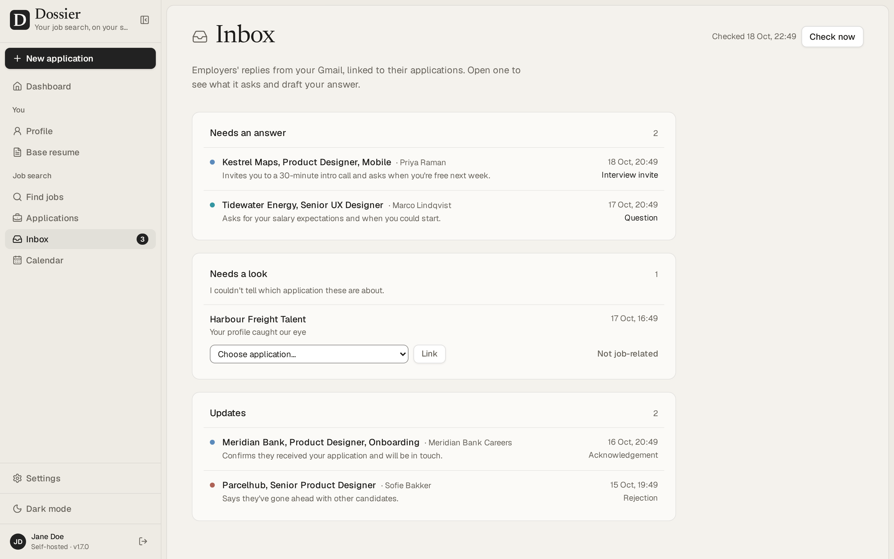
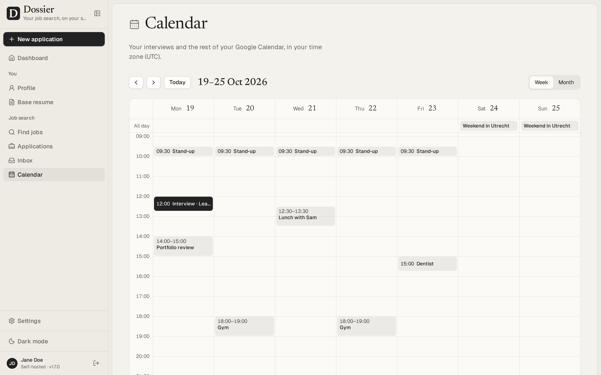

<p align="center">
  
</p>

<h1 align="center">Dossier</h1>

<p align="center">
  Your job search, on your own server: one profile, a tailored resume and cover letter for every job, and every application tracked from draft to offer.
</p>

<p align="center">
  <a href="https://github.com/AienTech/dossier/releases/latest"></a>
  <a href="https://github.com/AienTech/dossier/actions/workflows/ci.yml"></a>
  <a href="LICENSE"></a>
  <a href="https://github.com/AienTech/dossier/pkgs/container/dossier"></a>
  
  
</p>

Dossier keeps your career history in one profile and turns it into a clean resume. For every job you apply to, it reads the posting, shows how you match, and drafts a tailored resume and cover letter that only use facts from your profile. You refine them in a chat, download them as PDFs and track each application from draft to offer.

It's for one person on a small server: one password, your data in your own PostgreSQL database, and an AI model of your choice. That can be a local model through Ollama or LM Studio, so your profile and documents stay on your own hardware, or a hosted one (any OpenAI-compatible API, Anthropic or Mistral), which then receives what it writes from. [Privacy](https://github.com/AienTech/dossier/wiki/Privacy) says what goes where.

**Get started:** [run it on your computer](#run-it-on-your-computer) in a few minutes, or [self-host it](#self-hosting) on a server. The [installation guide](https://github.com/AienTech/dossier/wiki) covers every way: Docker with or without Compose, Node.js, a plain Ubuntu server, CapRover, Coolify and Dokploy.

## Demo


<sub>Recorded with the demo data (Jane Doe is made up) and a stand-in AI server that answers at once, played at 1.2× speed. With a real model, reading a posting and writing the documents takes from a few seconds to a few minutes.</sub>

## Features

- **Profile:** basics, skills and languages, experience, projects, education, publications and references, in the order you choose, with a strength meter that counts only what a profile needs. Projects (side, open-source, course or thesis work) show what you can do where your job titles don't yet. Publications are cited in your own style, with bold and italics, and go on resumes word for word. Start it from an existing resume (PDF, Word or Markdown) if you like.
- **Base resume:** twelve themes and a theme builder, previewed live and printed to PDF on the server. Duplicate themes, or share them as files.
- **Find jobs:** search postings near your city, or anywhere you choose, through JSearch (LinkedIn, Indeed and more) or Adzuna. Save the good ones, dismiss the rest, score any of them against your profile, and start an application from a posting with one click.
- **Startups:** startups that are hiring, from YC startups' job posts and Hacker News' monthly “Who is hiring?” thread, kept to the ones that hire where you live or remotely from your country and ranked against your profile, with the address each one publishes for applications. Dossier reads their sites politely and follows their robots.txt. Start an application to one with a click; you decide whom to write to.
- **Job agent (optional):** once a day it runs one search for you, skips what you've seen, scores the new postings against your profile and keeps the best on the Agent screen, with its reasons. It can prepare tailored drafts too, which wait for your review. It never sends or applies.
- **New application:** paste a posting; Dossier pulls out the details and requirements, matches them against your profile, and writes a tailored resume and cover letter in the tone you pick.
- **Never invents experience:** drafts only use facts from your profile. What the posting asks for and your profile doesn't have is shown as a gap, not made up.
- **Refine:** ask for changes in a chat, edit or regenerate any part (every part of the cover letter too: sender, date, recipient, greeting and sign-off, written in the letter's language), undo AI changes or go back to any earlier version, keep private notes.
- **Send:** an email to go with each application, to whoever the posting says to send it to, ready to copy or open in your mail app, with the resume and cover letter PDFs to attach. Edit, rewrite or refine it like the documents.
- **Signature:** upload a PNG or JPG of your handwritten signature in Settings → Documents, and sign new cover letters by default or switch it on per application on its Cover letter tab. The signature is printed on the PDF above your typed name and stays on your server.
- **Claude connector (optional):** use Dossier from Claude, on claude.ai, in the Desktop and mobile apps or in Claude's command-line app, on your own Claude plan. Claude can search for jobs, score them against your profile, read your profile and applications, and save the resume and cover letter it writes as a Draft, checked like Dossier's own. It never sends or deletes anything. Without an AI model of Dossier's own, **Write it with Claude** hands a posting to a new Claude chat. Turn it on in Settings → Claude connector (see [Connecting Claude](https://github.com/AienTech/dossier/wiki/Connecting-Claude)).
- **Gmail and Calendar (optional):** connect your Google account to send an application from your own address with its PDFs attached, see employers' replies next to each application, have the AI read what they ask and draft your answer from your profile, offer interview times you're free, and see your month and the week ahead on the dashboard, with interviews kept in step with Google Calendar both ways. Nothing is sent without your confirmation. Set it up by entering your Google OAuth client in Settings → Google, or with `DOSSIER_GOOGLE_CLIENT_ID` and `DOSSIER_GOOGLE_CLIENT_SECRET` (see [Connecting Gmail and Calendar](https://github.com/AienTech/dossier/wiki/Connecting-Gmail-and-Calendar)).
- **Track:** a board and a table of every application, and a dashboard with your funnel (last 30 days, 90 days or all time), a week-by-week chart, what's worth a look next, upcoming interviews included, and a calendar.
- **Your data:** export and import everything as one file, nightly backups, and Delete everything.

## Screenshots


<table>
  <tr>
    <td width="50%"><br>An application: the tailored resume, and a chat to refine it</td>
    <td width="50%"><br>A new application: how you match the posting</td>
  </tr>
  <tr>
    <td><br>Every application on a board, from draft to offer</td>
    <td><br>Find jobs and start an application from a posting</td>
  </tr>
  <tr>
    <td><br>The base resume, with twelve themes and a theme builder</td>
    <td><br>One profile that every resume and letter comes from</td>
  </tr>
  <tr>
    <td><br>Replies from Gmail, read by the AI, with answers it drafts</td>
    <td><br>Your interviews and Google Calendar on the dashboard, kept in step</td>
  </tr>
</table>

<sub>The screenshots show the demo data: Jane Doe is made up.</sub>

## Run it on your computer

All you need is [Docker Desktop](https://docs.docker.com/desktop/) on macOS or Windows, or Docker Engine with its Compose plugin on Linux, and about 2 GB of free memory. Run the commands in a terminal: macOS's Terminal, Linux, or WSL on Windows.

**1. Fetch the Compose file** into a folder of its own, and make the secrets Dossier needs:

```bash
mkdir ~/dossier && cd ~/dossier
curl -fsSL -o compose.yml https://raw.githubusercontent.com/AienTech/dossier/main/compose.production.yml
echo "POSTGRES_PASSWORD=$(openssl rand -hex 24)" > .env
echo "DOSSIER_SECRET=$(openssl rand -base64 32)" >> .env
```

On an Apple Silicon Mac, also run `printf 'services:\n  app:\n    platform: linux/amd64\n' > compose.override.yml`: the image is built for Intel and AMD processors, and Docker Desktop runs it under emulation.

**2. Choose your password.** This asks for it twice and prints a hash of it, one line that starts with `argon2id:`:

```bash
docker run --rm -it --platform linux/amd64 ghcr.io/aientech/dossier hash-password
```

Add that line to `.env` as `DOSSIER_PASSWORD=argon2id:…`, with any text editor. Dossier only keeps the hash, never the password.

**3. Start it:**

```bash
docker compose up -d
```

The first start downloads the image (about 1.7 GB) and sets up the database. Open [http://localhost:3000](http://localhost:3000), sign in with your password, and pick an AI model in **Settings → AI provider** (see [Choosing an AI provider](https://github.com/AienTech/dossier/wiki/Choosing-an-AI-provider)).

`docker compose stop` stops it and `docker compose start` starts it again, with your data kept. It's only reachable from your own computer. The [installation guide's Docker Compose page](https://github.com/AienTech/dossier/wiki/Run-locally-with-Docker-Compose) has more: another port, your time zone, upgrades and removing it.

## Self-hosting

To put Dossier on a server, on your own domain with HTTPS, follow the [installation guide](https://github.com/AienTech/dossier/wiki#self-host-on-a-server): a plain Ubuntu server with Docker Compose and Caddy (or Node.js, without Docker), CapRover, Coolify or Dokploy. Give the server at least 2 vCPUs and 2 GB of memory (see [Performance and sizing](#performance-and-sizing)).

## Documentation

The [wiki](https://github.com/AienTech/dossier/wiki) has what comes after installing:

- [Choosing an AI provider](https://github.com/AienTech/dossier/wiki/Choosing-an-AI-provider): a hosted model, or a local one with Ollama or LM Studio.
- [Choosing a job source](https://github.com/AienTech/dossier/wiki/Choosing-a-job-source): JSearch or Adzuna (and an unofficial one for Germany), and the job agent.
- [Connecting Gmail and Calendar](https://github.com/AienTech/dossier/wiki/Connecting-Gmail-and-Calendar): your own Google OAuth client, step by step.
- [Connecting Claude](https://github.com/AienTech/dossier/wiki/Connecting-Claude): the Claude connector, in Claude's apps and on the command line.
- [Backups and restore](https://github.com/AienTech/dossier/wiki/Backups-and-restore): exports, nightly backups and database dumps.
- <a name="upgrading"></a>[Upgrading](https://github.com/AienTech/dossier/wiki/Upgrading) to a new version.
- [Troubleshooting](https://github.com/AienTech/dossier/wiki/Troubleshooting): what the common errors mean, and what to do about them.
- [Privacy](https://github.com/AienTech/dossier/wiki/Privacy): what stays on your server and what leaves it. [PRIVACY.md](PRIVACY.md) has the details.
- [Environment variables](https://github.com/AienTech/dossier/wiki/Environment-variables): every setting the server reads.

## Known limitations

- **Desktop only:** made for a laptop or desktop browser, not for phones.
- **Single user:** one password and one profile; there are no accounts.
- **English interface:** the app itself is in English. Documents can be written in other languages; in the 21 built-in ones, their headings, dates and language levels are in that language too, and in one added with **Other language…** those stay in English.
- **One instance:** run a single copy of the app per database. The nightly backups, the AI job queue and the PDF browser live inside the app's process.

## Performance and sizing

Measured on 28 September 2026 with the production build in a container limited to 2 vCPUs and 1 GB:

- **PDFs:** the base resume renders in about 0.25 s, or 1 s when Chromium has to start first (it closes after five idle minutes). Two render at a time and the rest queue: six requested at once are done in 1.4 s. Dossier used at most about 520 MB, Chromium included, so give the container at least 768 MB.
- **Screens:** with ten times the demo data (90 applications), the dashboard and the applications list answer in 20–90 ms, and every query takes under a millisecond. With 900 applications they take up to about 0.2 s, mostly rendering; the tables are indexed for the queries they get.
- **Interactions** (changing a status, moving a card, switching tabs, opening an editor, typing, picking a theme) respond within 32 ms, and within about 100 ms on a CPU four times slower.

## Security

What protects your data, how to run Dossier safely and how to report a problem: see [SECURITY.md](SECURITY.md).

## Development

Working on Dossier itself: see [DEVELOPMENT.md](DEVELOPMENT.md). For this deployment's AWS/Lightsail operations — SSH, updates, backups, password and secret rotation — see [INFRASTRUCTURE.md](INFRASTRUCTURE.md).

## License

Dossier is free software under the [GNU Affero General Public License v3.0](LICENSE). You may use, change and share it; if you run a changed version for others over a network, you must offer them its source code.
